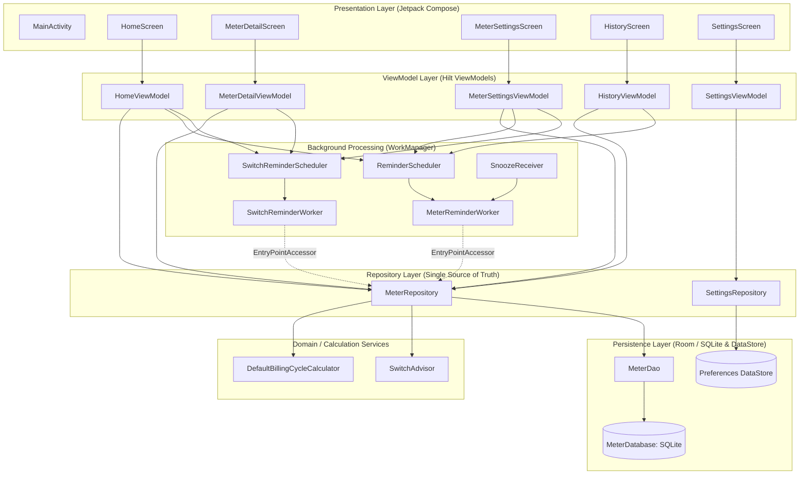

# KWH Android App — Technical Architecture & Data Flow

## 1. Architectural Style & Overview

The KWH Android application follows the **Modern Android Architecture (MVVM + Repository)** pattern recommended by Google, fully implemented with **Jetpack Compose** for presentation, **Kotlin Coroutines and Flow** for reactive asynchronous streams, **Dagger Hilt** for dependency injection, **Room** for relational SQLite storage, **DataStore** for user preferences, and **WorkManager** for reliable background tasks.

### Architecture Topology Diagram

---

## 2. Layer-by-Layer Breakdown

### 2.1 Presentation Layer (UI)
- **Single Activity**: `MainActivity` serves as the sole entry point (`ComponentActivity`), initializing edge-to-edge drawing, setting up Material 3 theme wrapper (`KwhTheme`), hosting the Compose `NavHost`, and managing high-level dialogs (such as `AddReadingDialog` and notification permission launchers).
- **Navigation Graph**: Powered by Jetpack Navigation Compose (`androidx.navigation.compose:2.8.3`):
  - `home`: The root dashboard showing environments, switch recommendations, ungrouped meters, and quick actions.
  - `meterDetail/{meterId}`: Meter-specific focal screen with circular reading gauge, daily burn rate, projected cycle units, and action triggers.
  - `history/{meterId}`: Historical reading log with time-period chips (All, 7d, 30d, 365d), cycle summary, visual trend chart, and CSV export/import.
  - `meterSettings/{meterId}`: Form for meter attributes (name, billing anchor, thresholds, reminder frequency, safety buffer, environment association).
  - `settings`: Application-wide settings (dark mode toggle, reminder snooze slider).
- **State Management**: ViewModels expose immutable `StateFlow<UiState>` collected via `collectAsStateWithLifecycle()`. One-off UI side effects (e.g. Snackbars, navigation triggers, CSV intents) are dispatched through buffered Kotlin `Channel<Event>` exposed as `receiveAsFlow()`.

### 2.2 ViewModel Layer
- **`HomeViewModel`**: Combines `MeterRepository.environmentOverviews` and `ungroupedMeterOverviews` into a single reactive dashboard state. Manages meter activation and triggers switch check rescheduling.
- **`MeterDetailViewModel`**: Tracks meter details and environment switch recommendations for the focal meter. Provides one-tap "Mark switched" handling.
- **`MeterSettingsViewModel`**: Manages dirty form state for meter attributes, validation rules (anchor 1–31, frequency >= 1, buffer 1–10), environment assignment/creation, and deletion.
- **`HistoryViewModel`**: Manages reading filters, reading deletion with undo, in-memory trend chart point computation, and CSV serialization/deserialization (format v2).
- **`SettingsViewModel`**: Binds app theme and notification snooze length to `SettingsRepository`.

### 2.3 Domain & Calculation Engines
- **`BillingCycleCalculator` (`DefaultBillingCycleCalculator`)**: Pure algorithmic component that computes the half-open `CycleWindow(start, end)` based on utility anchor day and clock.
- **`SwitchAdvisor`**: Stateless domain evaluator that converts a threshold forecast (`ThresholdForecast`) and meter safety buffer into a dated `SwitchRecommendation` with an urgency enum (`NORMAL`, `SOON`, `OVERDUE`). Pinpoints the switch target as the least-used non-active sibling.

### 2.4 Repository Layer
- **`MeterRepository`**: The central orchestrator (annotated `@Singleton`). 
  - Exposes hot flows (`meterOverviews`, `environmentOverviews`, `ungroupedMeterOverviews`) by combining Room DAO streams with live cycle calculations.
  - Implements adaptive calibration (`recalibrateSafetyBuffer`) to self-tune the meter's `safety_buffer_days`.
  - Serves as the sole gateway for Meter, Reading, Environment, Activation, and SwitchOutcome persistence.
- **`SettingsRepository`**: Wraps Jetpack Preferences DataStore to provide atomic read/write flows for `dark_theme` and `snooze_minutes`.

### 2.5 Persistence Layer (Room Database & DataStore)
- **Room Database (`MeterDatabase`, version 4)**:
  - SQLite database named `"meter.db"`.
  - Entities: `MeterEntity`, `MeterReadingEntity`, `EnvironmentEntity`, `MeterActivationEntity`, `SwitchOutcomeEntity`.
  - Foreign Keys: `meter_id` in readings, activations, and switch outcomes points to `meters(id)` with `onDelete = ForeignKey.CASCADE`.
  - Automated migrations: `MIGRATION_1_2`, `MIGRATION_2_3`, `MIGRATION_3_4`.
- **DataStore (`settings`)**:
  - Top-level `Context.dataStore by preferencesDataStore(name = "settings")`.

### 2.6 Background & System Services Layer
- **WorkManager (`androidx.work:work-runtime-ktx:2.9.1`)**:
  - `MeterReminderWorker`: Schedules periodic reading reminders (`meter_reminder_{meterId}`) using one-time work requests with initial delay, self-rescheduling upon completion. Injects proactive threshold warnings (within 7 days) and no-reading nudges (>10 days into cycle).
  - `SwitchReminderWorker`: Daily self-rescheduling worker (`switch_reminder_{meterId}`) that inspects switch urgency and notifies when urgency reaches `SOON` or `OVERDUE`.
- **Worker Injection**: Workers resolve dependencies using `EntryPointAccessors.fromApplication(applicationContext, WorkerEntryPoint::class.java)` rather than custom `WorkerFactory`, ensuring standard WorkManager initialization functions cleanly.
- **BroadcastReceiver (`SnoozeReceiver`)**: Registered in `AndroidManifest.xml` (non-exported) to intercept notification snooze action clicks and schedule one-off delayed reminder alarms.

---

## 3. Dependency Injection Graph (Dagger Hilt)

Hilt modules are installed in `SingletonComponent`:

| Module | Provided Dependency | Scope | Notes |
|---|---|---|---|
| `BillingModule` | `BillingCycleCalculator` | `@Singleton` | Returns `DefaultBillingCycleCalculator` |
| `BillingModule` | `Clock` | `@Singleton` | Returns `Clock.systemDefaultZone()` |
| `DatabaseModule` | `MeterDatabase` | `@Singleton` | Creates Room builder with `MIGRATION_1_2` |
| `DatabaseModule` | `MeterDao` | Default | Returns `database.meterDao()` |
| `ReminderModule` | `ReminderScheduler` | `@Singleton` | Injected with context & `SnoozePreferenceReader` |
| `ReminderModule` | `SwitchReminderScheduler` | `@Singleton` | Injected with application context |
| `RepositoryModule` | `MeterRepository` | `@Singleton` | Injected with `MeterDao`, `Clock`, `BillingCycleCalculator` |
| `SettingsModule` | `SettingsRepository` | `@Singleton` | DataStore manager |
| `SettingsModule` | `SnoozePreferenceReader` | `@Singleton` | Binds `SettingsRepository` as reader |
| `UiModule` | `StringResolver` | `@Singleton` | Returns `AndroidStringResolver(context)` |

---

## 4. Architectural Strengths & Structural Faults

### Strengths
1. **Unidirectional Data Flow (UDF)**: ViewModels maintain clear UI state separation, making Compose recomposition predictable.
2. **Offline-First Reactive Streams**: Flow-based updates ensure that changes to readings or activations immediately cascade across all screens without manual polling.
3. **Domain Decoupling**: Billing math (`BillingCycleCalculator`, `SwitchAdvisor`) is completely isolated from Android SDK dependencies, allowing pure unit testing.
4. **Self-Healing Background Workers**: Workers self-reschedule and verify that their parent meters still exist before performing work.

### Structural Faults & Coexisting Styles
1. **DI Migration Omission in `DatabaseModule`**:
   `MeterDatabase.get()` in companion object includes `MIGRATION_1_2`, `MIGRATION_2_3`, and `MIGRATION_3_4`. However, `DatabaseModule.provideDatabase()` registers **only** `MIGRATION_1_2`. Because Hilt is the sole instantiation path in production, any device migrating from database schema v2 or v3 will crash on startup with an `IllegalStateException`.
2. **Dual Database Instantiation Patterns**:
   `MeterDatabase` declares a singleton pattern (`INSTANCE ?: synchronized(...)`) in its companion object alongside Hilt's `DatabaseModule`. The companion singleton is never invoked in the main app; only Hilt is used.
3. **Calculation Coupling in Repository**:
   `MeterRepository` directly computes `buildCycleStats` and `recalibrateSafetyBuffer` internally rather than delegating to dedicated domain use cases or calculation engines.
